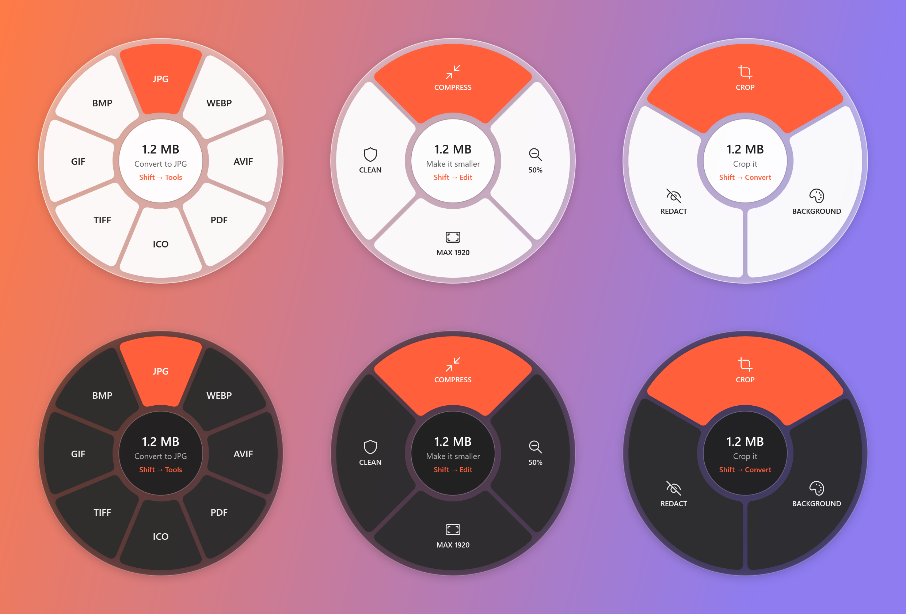

# ShiftDrop

Convert and shrink files on Windows without opening an app: start dragging a file, press **Shift**, and drop it
on an action in the wheel that appears. The new file lands next to the original.

<p align="center"></p>

> **Status: early prototype (v0.2).** Images work: conversion between nine formats, compression, resizing and
> metadata removal. Documents, video and audio are on the roadmap below.

## What works today

- **Drag + Shift** anywhere a file can be dragged (File Explorer, the desktop) opens the wheel under the cursor.
  **Press Shift again** to turn to the next page.
- **Convert**: PNG, JPG, WebP, AVIF, PDF, ICO, TIFF, GIF and BMP. It also reads HEIC (iPhone photos), JPEG XL and
  PSD, with no codec extensions to install.
  - Photos are turned upright using their EXIF orientation. Transparent areas become white in formats without
    transparency (JPG, BMP).
  - Animations (GIF, WebP and animated PNG) stay animated when converted to GIF or WebP. A multi-page TIFF
    becomes a multi-page PDF.
  - PNGs ShiftDrop writes carry no metadata the original didn't have (no timestamps or tool-specific chunks).
  - PDF pages come out about A4-sized, at the image's full resolution.
  - ICO files hold every standard size (16–256 px) without scaling small images up.
- **Tools**:
  - **Compress**: a JPEG saved above quality 80 (phones use about 92–96) is re-saved at 80, often halving it;
    otherwise it is optimized losslessly. PNG and GIF are optimized losslessly; WebP is re-encoded. Animated PNGs
    are left alone rather than losing their animation (convert them to WebP instead).
  - **50%** and **Max 1920** (fit within 1920 × 1920 px), keeping the format and the animation.
  - **Clean** removes location, camera details, comments and other metadata from JPEG and PNG *without
    re-encoding*: the image data is copied byte for byte, and the orientation is kept so photos don't turn sideways.
- **Never overwrites anything**: results are named `photo (compressed).jpg`, `photo (1).png` and so on.
- Drop on the hub (centre) or drag away to cancel. Drag a few files at once to process them all.

HEIC can be read but not written: the HEVC encoder (x265) is GPL-licensed, so Magick.NET doesn't ship it.

## How it works

| Piece | What it does |
| --- | --- |
| [`Input/DragWatcher`](src/ShiftDrop/Input/DragWatcher.cs) | A low-level mouse hook on its own thread notices "button held + moved past the drag threshold", then watches for Shift presses. Shift held *before* the drag keeps Explorer's native meaning (force move). |
| [`Overlay/WheelWindow`](src/ShiftDrop/Overlay/WheelWindow.xaml.cs) | A topmost, non-activating, layered WPF window that is an OLE drop target. It appears under the cursor as an invisible "ghost" and only shows itself when the drag really enters it carrying files, so text selection or window moves never show it. |
| [`Actions/`](src/ShiftDrop/Actions) | What each slice does (`IFileAction`), grouped into pages and chosen from the first file's type, run in the background. |
| [`Imaging/`](src/ShiftDrop/Imaging) | [Magick.NET](https://github.com/dlemstra/Magick.NET) for decoding and encoding, plus a small ICO writer and byte-level JPEG/PNG metadata removal. Files are identified by their first bytes, so only decoders on ShiftDrop's list ever see them. |

ShiftDrop always answers drops with *Copy*, never *Move*, so the source never deletes your original.

## Build and run

Requirements: Windows 10 or 11 and the [.NET 10 SDK](https://dotnet.microsoft.com/download).

```bash
dotnet build
dotnet test
dotnet run --project src/ShiftDrop
```

ShiftDrop lives in the notification area (tray). Right-click its icon to pause it, turn on **Start with Windows**
(off by default), open the log, or exit. Jobs that take more than a moment show a "Working…" notification.
The log is at `%LOCALAPPDATA%\ShiftDrop\shiftdrop.log`.

Developer switches:

- `ShiftDrop.exe --render-wheel wheel.png` renders the wheel's pages to an image without showing any window.
- `ShiftDrop.exe --exit` closes a running instance (useful before rebuilding).

## Roadmap

1. ~~Gesture, wheel and built-in image conversion~~ (v0.1)
2. ~~WebP / AVIF / HEIC, compress, resize, remove metadata~~ (v0.2)
3. PDF ↔ images, editing tools (crop, add background, redact)
4. Video and audio (FFmpeg, downloaded on first use)
5. Settings: start with Windows, choose the modifier key, light/dark theme
6. Installer, winget and signed releases

## Known limitations

- Windows blocks drag and drop from apps running as administrator to normal apps, so the wheel can't receive those drops.
- Files dragged out of ZIP folders or phones (virtual files) aren't supported yet.

## Third-party software

- [Magick.NET](https://github.com/dlemstra/Magick.NET) (Apache 2.0), which bundles
  [ImageMagick](https://imagemagick.org/script/license.php) and its codec libraries (libheif, libwebp, libaom,
  libjxl and others) under their own licenses.

## License

[MIT](LICENSE)
